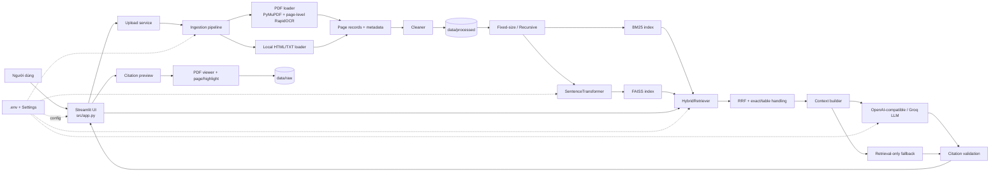
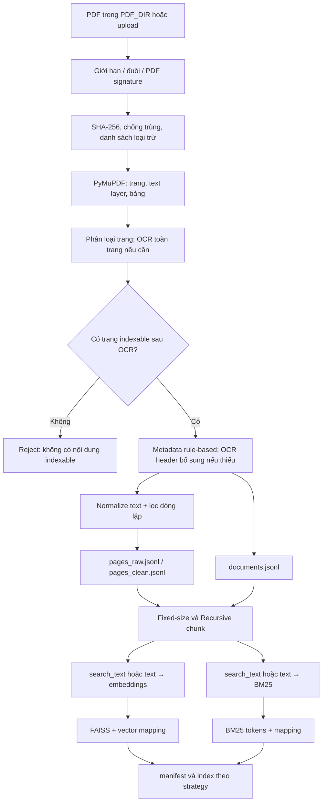
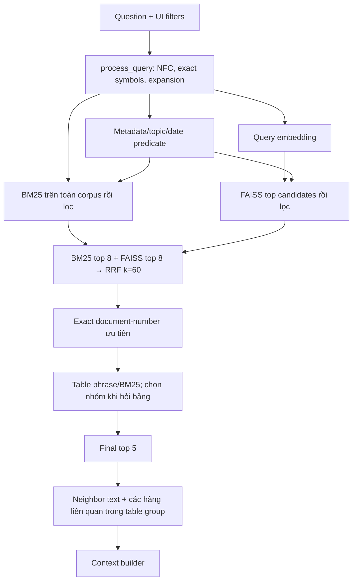
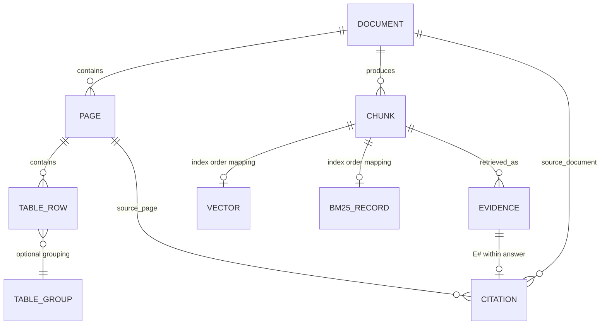

# Kiến trúc và pipeline của School Document Hybrid RAG

## 1. Giới thiệu

Project là cổng tra cứu văn bản tiếng Việt xây dựng bằng Streamlit. Người dùng chọn một trong hai bộ chỉ mục chunking, tìm kiếm bằng BM25 và FAISS, hợp nhất thứ hạng bằng Reciprocal Rank Fusion (RRF), rồi xem bằng chứng và câu trả lời có citation. LLM là tùy chọn; khi không gọi được LLM, ứng dụng vẫn có thể trả về trạng thái retrieval-only cùng các nguồn đã truy xuất.

Tài liệu này mô tả implementation có thể xác minh trong source. Các nhãn được dùng như sau:

- **Implemented**: có code và được nối vào luồng chạy.
- **Partially implemented**: có một phần chức năng nhưng còn giới hạn được nêu rõ.
- **Not implemented**: chưa thấy code thực hiện chức năng.
- **Proposed**: hướng cải tiến, chưa phải hành vi hiện tại.

Entry point giao diện là [`src/app.py`](../src/app.py); không có backend API riêng. Các lệnh ingestion, index và evaluation chạy như module Python độc lập.

## 2. Tổng quan kiến trúc



Sơ đồ thể hiện các component có thật, không hàm ý rằng mọi loại nguồn đều được xem như PDF: `source_viewer` hiện giải quyết và mở PDF cục bộ.

## 3. Cấu trúc thư mục thực tế

```text
project/
├── .env.example
├── .gitignore
├── README.md
├── requirements.txt
├── .streamlit/
│   └── config.toml
├── data/
│   ├── evaluation/
│   │   └── questions.csv
│   ├── processed/
│   │   ├── documents.jsonl
│   │   ├── pages_raw.jsonl
│   │   ├── pages_clean.jsonl
│   │   ├── ingestion_valid.jsonl
│   │   ├── ingestion_rejected.jsonl
│   │   └── ingestion_summary.json
│   ├── raw/
│   │   ├── pdf/
│   │   ├── uploaded/
│   │   └── web/
│   └── uploaded_documents.jsonl
├── indexes/
│   ├── fixed_size/
│   └── recursive/
├── results/
│   ├── cases/
│   ├── figures/
│   └── metrics/
├── src/
│   ├── app.py
│   ├── config.py
│   ├── models.py
│   ├── chunking/
│   ├── embedding/
│   ├── evaluation/
│   ├── indexing/
│   ├── ingestion/
│   ├── rag/
│   ├── retrieval/
│   └── ui/
└── tests/
```

`data/processed`, `indexes`, `results` và upload registry chứa dữ liệu sinh trong quá trình chạy. `.gitignore` loại dữ liệu processed, PDF nguồn, index và kết quả khỏi theo dõi Git theo các quy tắc hiện có; một số thư mục và artifact có thể được giữ lại cục bộ. `.upload-index.lock` ở root là lock file runtime. `.venv`, cache Python và pytest cache là môi trường/cache, không phải module ứng dụng.

### 3.1 Vai trò module và luồng gọi

| Thành phần | Vai trò / đầu vào → đầu ra | Được gọi bởi |
|---|---|---|
| [`src/app.py`](../src/app.py) | **Implemented.** Khởi tạo Streamlit; nạp bundle/retriever; cung cấp upload, bộ lọc, search/chat, catalog, citation preview và PDF view. Query → retrieval → evidence → answer/source. | `streamlit run src/app.py` |
| [`src/config.py`](../src/config.py) | **Implemented.** `Settings` lấy giá trị mặc định và `.env`/environment, kiểm tra `chunk_size`, `chunk_overlap`; cung cấp các đường dẫn, model và giới hạn. | Toàn bộ module sử dụng `settings` |
| [`src/models.py`](../src/models.py) | **Implemented.** Pydantic records `DocumentMetadata`, `PageRecord`, `TableRowRecord`, `TableCellSpan`, `ChunkRecord`, `SearchFilter`. | Ingestion, chunking, retrieval, RAG |
| [`src/ingestion/`](../src/ingestion) | **Implemented.** Đọc, kiểm tra và chuẩn hóa PDF cùng HTML/TXT cục bộ; tạo page records, metadata/provenance, page-level OCR và review metadata. | CLI ingestion; upload service; metadata review UI |
| [`src/chunking/`](../src/chunking) | **Implemented.** Fixed-size hoặc recursive page chunking; tạo table-row chunks và thống kê. Hai chiến lược được index riêng. | `indexing.index_manager.build_strategy` |
| [`src/embedding/embedder.py`](../src/embedding/embedder.py) | **Implemented.** SentenceTransformer CPU embeddings chuẩn hóa L2. | Index builder; lazy query embedder trong retriever |
| [`src/indexing/`](../src/indexing) | **Implemented.** Tạo/nạp BM25, FAISS, chunk store và mapping theo chiến lược. | CLI index; UI; upload service; evaluation |
| [`src/retrieval/`](../src/retrieval) | **Implemented.** Chuẩn hóa/mở rộng query, lọc metadata, truy xuất BM25+FAISS, RRF và xử lý bảng/liền kề. | `answer_query` trong UI; evaluation |
| [`src/rag/`](../src/rag) | **Implemented.** Chọn evidence, dựng prompt, gọi LLM, kiểm chứng citation, tìm nguồn PDF. | `answer_query`; UI components |
| [`src/ui/components.py`](../src/ui/components.py) | **Implemented.** Render câu trả lời Markdown với citation tương tác, preview, điều hướng và PDF. | `src/app.py` |
| [`src/evaluation/`](../src/evaluation) | **Implemented.** Chỉ đánh giá câu hỏi có ground truth đã xác minh; tính metrics theo document cho BM25/FAISS/hybrid, ghi report và template đánh giá thủ công. | `python -m src.evaluation.report` |
| [`tests/`](../tests) | **Implemented.** Kiểm thử theo chức năng, không được import như một phần runtime của ứng dụng. | `pytest` |

`src/__init__.py` và các `__init__.py` của package chỉ khai báo package. Không có thư mục `src/api`, `src/backend`, `src/citation` hay thư mục `config` độc lập; không nên hiểu UI Streamlit là một REST API.

### 3.2 Các file module đáng chú ý

- Ingestion: [`pdf_loader.py`](../src/ingestion/pdf_loader.py) (`read_pdf`, table extraction, page-level OCR); [`metadata_extractor.py`](../src/ingestion/metadata_extractor.py) (`extract_pdf_metadata`, `extract_metadata`); [`metadata_review.py`](../src/ingestion/metadata_review.py) (review persistence and transactional reindex); [`validator.py`](../src/ingestion/validator.py) (`validate_pdf`); [`cleaner.py`](../src/ingestion/cleaner.py) (`clean_pages`); [`ingestion_pipeline.py`](../src/ingestion/ingestion_pipeline.py) (`run_ingestion`, `load_page_records`); [`upload_service.py`](../src/ingestion/upload_service.py) (`process_pdf_uploads`); [`web_loader.py`](../src/ingestion/web_loader.py) (`load_web_file`).
- Chunking: [`common.py`](../src/chunking/common.py) dùng chung section/chunk/table construction; [`fixed_size.py`](../src/chunking/fixed_size.py) và [`recursive.py`](../src/chunking/recursive.py) sinh hai corpus; [`statistics.py`](../src/chunking/statistics.py) ghi thống kê chunk.
- Index/retrieval: [`index_manager.py`](../src/indexing/index_manager.py) (`build_strategy`, `load_strategy`, CLI); [`bm25_index.py`](../src/indexing/bm25_index.py); [`faiss_index.py`](../src/indexing/faiss_index.py); [`hybrid_retriever.py`](../src/retrieval/hybrid_retriever.py); [`query_processor.py`](../src/retrieval/query_processor.py); [`rrf.py`](../src/retrieval/rrf.py).
- RAG/UI: [`context_builder.py`](../src/rag/context_builder.py) (`build_context`); [`prompt.py`](../src/rag/prompt.py); [`answer_generator.py`](../src/rag/answer_generator.py) (`generate_answer`); [`citation_validator.py`](../src/rag/citation_validator.py); [`source_viewer.py`](../src/rag/source_viewer.py); [`components.py`](../src/ui/components.py).
- Evaluation: [`dataset.py`](../src/evaluation/dataset.py), [`retrieval_metrics.py`](../src/evaluation/retrieval_metrics.py), [`report.py`](../src/evaluation/report.py), [`answer_evaluator.py`](../src/evaluation/answer_evaluator.py), [`case_analysis.py`](../src/evaluation/case_analysis.py).

## 4. Ingestion pipeline



### 4.1 Tiếp nhận và định danh

- **Local ingestion — Implemented:** `run_ingestion()` quét đệ quy `settings.pdf_dir` tìm `*.pdf`, mặc định `data/raw`. Không giới hạn dung lượng ở luồng CLI này. Có thể loại trừ bằng `EXCLUDED_DOCUMENTS`.
- **Upload — Implemented:** `src/app.py` nhận nhiều PDF qua Streamlit; `process_pdf_uploads()` kiểm tra đuôi, dữ liệu không rỗng, giới hạn `MAX_PDF_UPLOAD_MB` và chữ ký `%PDF-`. File đã upload được lưu dưới `data/raw/uploaded/` theo tên gồm 16 ký tự đầu của SHA-256 và tên an toàn. Upload registry nằm ở `data/uploaded_documents.jsonl`.
- Validator kiểm tra PDF signature, đọc được PDF, PDF không mã hóa, ít nhất một trang, có text hoặc bảng được trích xuất, trùng SHA-256 và danh sách loại trừ. Số định danh có thể là dữ liệu cá nhân (9 hoặc 12 chữ số) khiến tài liệu bị từ chối để rà soát; code không che/redact riêng chuỗi đó.
- `document_id_for()` tạo `doc_` + 16 ký tự đầu SHA-256 của đường dẫn tương đối đã case-fold, không phải hash nội dung. `file_hash` riêng là SHA-256 toàn file. Vì vậy thay file tại cùng đường dẫn có thể giữ document ID nhưng thay content hash. Upload có thêm hash trong tên file và do đó thường tạo đường dẫn/document ID riêng.
- File trùng được nhận diện theo content hash; ingestion local đưa file trùng vào `ingestion_rejected.jsonl`. Upload trả trạng thái `duplicate` mà không index lại.

### 4.2 PDF, text layer, bảng và OCR

- **PDF text extraction — Implemented:** `read_pdf()` dùng PyMuPDF, mở từng trang và lấy `page.get_text("text", sort=True)`. `page_no` là 1-based theo thứ tự trang PDF.
- **Bảng — Partially implemented:** PyMuPDF `find_tables()` được dùng để trích xuất từng hàng/cell từ text PDF, kèm header, `table_id`, bounding box, trạng thái ô và cell spans. Bảng scan/hình ảnh không được OCR thành bảng; vị trí bbox và nội dung rỗng được giữ để tránh khẳng định ô trống khi có thể chưa trích xuất được.
- **OCR toàn trang — Implemented có quality gate:** `read_pdf()` phân loại từng trang dựa trên text layer và diện tích ảnh; trang scan/hybrid được render ở `OCR_RENDER_SCALE` và xử lý bằng RapidOCR. Lưu text layer gốc, vùng nhận dạng/confidence, bbox đổi về tọa độ PDF và thống kê chất lượng theo trang. Text OCR chỉ được index khi đạt ngưỡng ký tự hợp lệ, số ký tự tối thiểu và confidence; OCR chất lượng thấp không được dùng thay text layer hợp lệ và được gắn trạng thái/cảnh báo để review.
- **Validation — Implemented:** preflight cấu trúc không yêu cầu text layer, để scan có thể đi qua tới OCR. Sau extraction, validation kiểm tra trang có nội dung indexable và rà PII cả text/OCR; tài liệu không có trang dùng được bị từ chối. OCR confidence là tín hiệu chất lượng, không phải xác nhận độ chính xác transcription. OCR vùng header vẫn có thể chạy bổ sung nếu metadata số hiệu/ngày còn thiếu.
- Lỗi mở PDF, PDF mã hóa, trang không đọc được hoặc không có nội dung được bắt ở mức tài liệu và ghi vào danh sách rejected; không có cơ chế cô lập để tiếp tục xử lý riêng trang lỗi trong cùng PDF.

### 4.3 Metadata và provenance

`DocumentMetadata` trong [`src/models.py`](../src/models.py) chứa:

| Trường | Hiện trạng |
|---|---|
| `document_id`, `source_path`, `file_hash`, `accessed_at`, `page_count` | **Implemented.** ID theo đường dẫn tương đối; hash theo nội dung; đường dẫn tương đối với data root; thời điểm UTC; số trang PDF. |
| `document_type`, `title_subject`, `issuing_authority` | **Rule-based, có provenance.** Trích xuất từ nội dung đầu văn bản; các quy tắc nhận diện có phạm vi hữu hạn, không phải bộ phân loại tổng quát. |
| `number_symbol`, `issue_date`, `issue_year` | **Implemented, cần review khi OCR.** Regex/heuristic kiểm tra ngữ cảnh để phân biệt ngày ban hành với thời gian thực hiện/được viện dẫn; ưu tiên text layer, có thể dùng OCR khi cần. |
| `number_symbol_raw`, `issue_date_raw`, `*_source`, `*_page`, `field_provenance` | **Implemented.** Lưu giá trị/evidence gốc, trang và phương pháp (`rule_based`, `ocr`, `human_review`) cho các trường metadata. |
| `effective_date`, `deadlines`, `document_relations` | **Rule-based, cần review.** Trích ngày hiệu lực, nhiều deadline và quan hệ thay thế/sửa đổi/bãi bỏ kèm evidence/trang; citation đơn thuần không được coi là quan hệ. `deadline`, `replaces`, `amends` còn được duy trì để tương thích. |
| `source_url` | **Partially implemented.** Web loader lấy URL từ file phụ `<file>.<suffix>.url` đã thu thập; không crawl web. |
| `printed_page` | **Not implemented.** Có trường trong PageRecord nhưng extractor không điền số trang in. |

Không dùng LLM để nhận diện metadata. Giá trị không chắc chắn giữ `null`; OCR hoặc lỗi OCR có thể đưa metadata vào `needs_manual_review`. UI cho phép chỉnh sửa metadata, xác nhận hoặc từ chối với reviewer/time/notes; xác nhận yêu cầu evidence và trang hợp lệ. Thay đổi được lưu vào JSONL, sau đó build/validate cả hai index ở staging trước khi publish. Ingestion giữ metadata đã review của cùng document ID và file hash.

Metadata extraction dựa trên regex/rule và evidence, không bảo đảm đúng tuyệt đối; các kết quả vẫn cần người có chuyên môn kiểm tra trước khi đánh dấu verified. Metadata registry ghi một JSON object mỗi dòng trong `documents.jsonl`.

### 4.4 Cleaning, page records và chất lượng

`clean_pages()` chuẩn hóa CRLF/CR thành LF, thay ký tự replacement `�` bằng khoảng trắng, rút gọn whitespace trong từng dòng và gộp từ ba dòng trống thành hai. Nó đếm dòng xuất hiện ở nhiều trang và loại bỏ dòng lặp với ngưỡng `max(2, (số_trang + 1) // 2)`.

Đây là cleaning bảo thủ, không phải sửa OCR: **không** có bước nối từ bị ngắt cuối dòng, sửa lỗi chính tả OCR, loại nội dung nhiễu theo ngữ nghĩa, hay khôi phục bố cục đoạn/danh sách. Text bảng được lưu riêng trong `table_rows`; cleaning chủ yếu áp dụng `PageRecord.text`.

`run_ingestion()` ghi:

- `pages_raw.jsonl`: trang sau trích xuất nguồn, trước cleaner.
- `pages_clean.jsonl`: trang sau chuẩn hóa và loại dòng lặp, dùng để chunk/index.
- `documents.jsonl`: metadata document.
- `ingestion_valid.jsonl`, `ingestion_rejected.jsonl`: danh sách chấp nhận/từ chối cùng lý do.
- `ingestion_summary.json`: thời điểm chạy, tổng document accepted/rejected, số trang và thống kê trang OCR theo trạng thái/chất lượng.

Trang OCR cần review được lưu lại cùng regions/reason; upload UI hiển thị danh sách số trang cảnh báo để người dùng rà soát. Đây là quality gate dựa trên các tín hiệu cấu hình, không phải đánh giá completeness hay độ chính xác ngữ nghĩa của OCR.

### 4.5 Chunking và table chunks

Hai chiến lược được triển khai trong [`fixed_size.py`](../src/chunking/fixed_size.py) và [`recursive.py`](../src/chunking/recursive.py). Mặc định `CHUNK_SIZE=900` ký tự và `CHUNK_OVERLAP=120`; cả hai chiến lược kiểm tra `size > overlap >= 0` và căn ranh giới gần whitespace.

- **Fixed-size — Implemented:** cắt nội dung text theo số ký tự mục tiêu, overlap cấu hình được.
- **Recursive — Implemented:** ưu tiên ranh giới heading (ví dụ Chương/Điều/Mục), đoạn trống và câu; phần quá dài quay về cắt theo kích thước/overlap.
- Cả hai xử lý từng trang độc lập; chunk text không nối qua trang. `page` và `end_page` cùng bằng số trang gốc.
- `section_for()` heuristic nhận một số kiểu tiêu đề; `make_chunk()` gắn `document_id`, `strategy`, section và bản sao metadata document.
- `chunk_id` là 20 ký tự đầu SHA-256 trên chuỗi document ID, strategy, page, vị trí bắt đầu và text. Cùng nội dung/vị trí/chiến lược tạo ID ổn định; thay đổi text/vị trí có thể đổi ID.
- **Table chunks — Partially implemented:** mỗi hàng bảng không rỗng tạo một chunk; `table_id` và `table_group_id` được tạo trong PDF loader theo document/page/table. Các bảng nối tiếp giữa hai trang chỉ được group khi header (và nếu có, title) khớp heuristic.
- Chunk bảng giữ header một/multi-level, cell, cell bbox, title, trạng thái merged/empty/not-extracted, cell origins và spans. `search_text` tạo dạng nhãn cột–giá trị và thêm title/tên tài liệu; `text` vẫn lưu cell values. Header chỉ được lấy từ hàng đầu tìm thấy, không phải table recognition tổng quát cho mọi PDF.
- Không có layout-aware chunking tổng quát, xử lý cấu trúc heading phức tạp, hay ràng buộc số token model ở bước chunking. Chunk thông thường không lưu bbox; bảng lưu bbox cell/table.

## 5. Embedding và indexing

### 5.1 Embedding

`SentenceTransformerEmbedder` dùng `sentence-transformers/paraphrase-multilingual-MiniLM-L12-v2` mặc định, chạy CPU với batch mặc định 32. Index builder encode `chunk.search_text or chunk.text`; vì vậy bảng thường embed văn bản có nhãn cột và ngữ cảnh, còn chunk thường embed text. Query embedding dùng nguyên câu hỏi.

Embedding được normalize trong SentenceTransformer và FAISS cũng normalize lại trước khi thêm/tìm; vector dùng `float32`. `encode()` kiểm tra chiều và giá trị hữu hạn, ném lỗi nếu sai. Vector không được lưu thành file ma trận riêng mà được lưu trong FAISS index; liên kết với chunk dựa trên thứ tự index và mapping JSON.

### 5.2 BM25, FAISS và manifest

`build_strategy()` nạp page records và metadata, chunk toàn corpus theo một chiến lược, tính fingerprint từ chunk JSON + tên model, rồi tạo hoặc tái sử dụng index:

- **BM25:** `rank_bm25.BM25Okapi`; tokenization regex Unicode, case-fold; tokens của `search_text` hoặc `text` lưu ở `bm25_tokens.json`.
- **FAISS:** `faiss.IndexFlatIP` trên vector L2-normalized, tức inner product tương đương cosine similarity; lưu `faiss.index`.
- **Chunk store:** `chunks.jsonl` lưu toàn bộ `ChunkRecord`.
- **Mapping:** `vector_mapping.json` và `bm25_mapping.json` lưu `{index, chunk_id}` theo thứ tự chunk. Loader đối chiếu mapping với corpus.
- **Manifest:** `manifest.json` lưu strategy, fingerprint, embedding model, chunk config, chunk count, vector count.
- **Thống kê:** `chunk_statistics.json` lưu số chunk, độ dài ký tự trung bình/min/max, chunk rỗng/thiếu metadata, số chunk theo document.

Index `fixed_size` và `recursive` là hai bộ độc lập. Mặc định builder tái sử dụng bộ hiện có khi fingerprint khớp và file cần thiết tồn tại; `--force` buộc rebuild. CLI `python -m src.indexing.index_manager --strategy both` build cả hai.

**Đồng bộ/transaction:**

- **Upload — Implemented:** upload lấy lock, staging vào thư mục transaction, chạy lại ingestion toàn bộ corpus, build cả hai chiến lược, xác minh document mới có chunk trong từng bundle, rồi thay hai thư mục `processed`/`indexes`. Có backup và rollback nếu publish hoặc ghi upload registry lỗi. Registry có status `processing`, `indexing`, `completed`, `duplicate`, `failed`.
- **CLI indexing — Partially implemented:** build đầy đủ các file index theo thứ tự trực tiếp trên thư mục đích, không có transaction/rollback chung bao trùm chunks, tokens, FAISS, mapping và manifest. Lỗi giữa chừng có thể để lại file không đồng bộ; loader kiểm tra manifest count và mappings khi load nhưng không chứng minh mọi file cùng fingerprint.
- Không có cập nhật vector đơn lẻ/incremental tại FAISS; upload tái xử lý/rebuild corpus trong staging. Fingerprint không thay thế backup hoặc versioning đầy đủ cho CLI.

## 6. Query và Hybrid Retrieval



### 6.1 Tiền xử lý query và filters

`process_query()` giữ query gốc, chuẩn hóa Unicode NFC, tạo tokens, nhận diện số hiệu văn bản và mở rộng một số cụm từ đồng nghĩa. Ngoài ra có heuristic nhận diện câu hỏi về lịch đăng ký, định danh văn bản, thời hạn nộp/đóng và mức phí theo tháng.

Đây là rule-based query processing, không có model phân loại intent. Một số synonym/schedule expansion là từ điển viết trong [`query_processor.py`](../src/retrieval/query_processor.py); đây là điểm cần lưu ý khi đánh giá tính tổng quát, không phải khả năng tổng quát tự sinh.

UI có selector strategy và các filter:

- `document_type`, `issuing_authority`: so khớp bằng nhau với metadata chunk.
- `issue_date_from`, `issue_date_to`: so ngày ISO; thiếu/sai ngày không qua filter nếu có khoảng ngày.
- `topic`: substring trong title + section + `search_text`/text.
- `strategy`: chọn thư mục index fixed-size hoặc recursive; không phải filter trường metadata của retriever.

Các predicate xác định tập chunk được phép dùng. Cách triển khai truy xuất BM25/FAISS trên corpus đầy đủ rồi loại kết quả không thỏa filter, do đó có thể tốn công hơn pre-filter index chuyên biệt. Filter được áp dụng tiếp cho exact match, table candidates và một số neighbor; không có lọc theo ACL/người dùng.

### 6.2 BM25, FAISS, RRF và mở rộng

1. Retriever tạo BM25 runtime corpus với title, số hiệu, section và nội dung search; riêng bảng có BM25 index/tokenization bổ sung header/cells.
2. BM25 tìm với query đã mở rộng; giữ tối đa `BM25_TOP_K=8` kết quả hợp lệ.
3. Query embedding bằng cùng model/embedding dimension với index; FAISS tìm inner product trên vector chuẩn hóa; giữ tối đa `FAISS_TOP_K=8` kết quả hợp lệ.
4. `reciprocal_rank_fusion()` tính `1 / (k + rank)` theo vị trí trong mỗi danh sách (mặc định `RRF_K=60`), cộng điểm cho chunk ID trùng và sắp theo điểm giảm dần.
5. Số hiệu văn bản nhận diện chính xác được ưu tiên trong danh sách kết quả; table query có thêm table phrase n-gram/BM25, chọn nhóm bảng phù hợp và có thể mở rộng toàn nhóm (đặc biệt câu hỏi lịch đăng ký/tổng hợp hàng).
6. Số kết quả lõi mặc định `FINAL_TOP_K=5`. Sau đó retriever bổ sung chunk text lân cận cùng document/page và hàng liên quan trong table group. Vì vậy `results` cuối có thể nhiều hơn `top_k`; RRF score của phần bổ sung có thể bằng 0 nếu nó không nằm trong BM25/FAISS fused ranking.

RRF khử lặp theo chunk ID trong mỗi ranking và hợp nhất theo ID. Không có dedupe tổng quát theo nội dung/tài liệu. Các nhánh lọc bảng cho câu hỏi mức phí/thời hạn là heuristic chuyên biệt, và nhóm bảng được chọn theo điểm khóa/header/từ khóa/title.

## 7. Context Builder và Answer Generation

`build_context()` nhận danh sách kết quả đã xếp hạng. Với text chunk, có thể chọn các câu/đoạn có liên quan theo token query; nếu không tìm thấy đoạn đạt heuristic thì giữ nguyên text. Với table chunk, chọn một số cột theo query và giữ nhãn cùng giá trị/state của cell. Nó giữ nguyên khác biệt giữa ô kế thừa từ merged cell, ô trống/không rõ, ô thuộc merged cell và nội dung có thể chưa trích xuất được.

Evidence được cấp ID `E1`, `E2`, ... theo thứ tự được chọn. Mỗi record mang `document_id`, `chunk_id`, title, số hiệu/ngày ban hành, `page`, section, nguồn, evidence text/segments, page_count và thông tin bảng/bbox/table location. ID này là mapping cho câu trả lời trong phiên, không phải ID bền vững qua các lần query.

`TOKEN_BUDGET=3000` được ước lượng xấp xỉ từ ký tự/4, không dùng tokenizer của LLM. Table group được dự trù chi phí để giữ nhóm nhất quán; với query lịch đăng ký, code cho phép nhóm bảng vượt budget. Do đó đây là giới hạn heuristic, không bảo đảm giới hạn token nhà cung cấp trong mọi tình huống.

`generate_answer()`:

- Trả câu “chưa tìm thấy bằng chứng” nếu context rỗng, không gọi model.
- Nếu thiếu `LLM_API_KEY` hoặc `LLM_MODEL`, ném lỗi cấu hình; UI bắt lỗi và tạo retrieval-only response.
- Hỗ trợ `LLM_PROVIDER=openai_compatible` qua HTTP chat-completions và `groq` qua OpenAI SDK. Prompt tiếng Việt yêu cầu chỉ dựa evidence, không tự suy diễn, phân biệt ngày ban hành/thời hạn, xử lý bảng có nhãn cột và gắn citation ngay sau phát biểu được hỗ trợ.
- Gọi model với temperature 0.1; timeout cấu hình. HTTP 502/503/504 được retry một lần sau 1 giây; lỗi HTTP/timeout/connection được chuyển thành lỗi hiển thị. Không có bước kiểm chứng factual độc lập bằng model khác; citation validation chỉ kiểm tra mapping/nguồn.

## 8. Citation và PDF Viewer

```mermaid
sequenceDiagram
    participant C as Context builder
    participant L as LLM / fallback
    participant V as Citation validator
    participant U as Streamlit UI
    participant R as Citation registry
    participant P as PDF source viewer
    C->>C: Tạo E1...En + chunk/document/page/source mapping
    C->>L: Evidence có ID + prompt
    L->>V: Answer chứa citation markers
    V->>V: Chỉ chấp nhận ID có evidence/source/page hợp lệ
    V->>U: Answer + source records hợp lệ + invalid IDs
    U->>R: Đăng ký source theo answer token và citation ID
    U->>U: Render citation inline + preview
    U->>R: Click citation / Xem nguồn
    R->>P: source_path + page + evidence/table locations
    P->>P: Resolve trong PDF_DIR, xác minh bằng chứng, tạo PDF view/highlight
    P->>U: PDF mở đúng trang; highlight nếu match duy nhất
```

### 8.1 Mapping và kiểm chứng

- `context_builder.build_context()` gán `evidence_id`/`citation_id` cục bộ cho mỗi evidence, đồng thời gắn `chunk_id`, `document_id`, trang, `source_path`/`source_url`, `page_count`, `evidence_text` và dữ liệu bảng.
- `validate_citations()` chuẩn hóa dạng `【E1】` hoặc dạng có line marker sang `[E1]` chỉ khi ID tồn tại và record có `document_id`, `chunk_id`, evidence text, nguồn URL/path và page hợp lệ. Citation sai mapping được liệt kê trong `invalid_citations`, không được biến thành link.
- `sources` trả về từ validator là source records theo citation ID đã dùng trong câu trả lời, không phải toàn bộ evidence.
- Nếu LLM lỗi, `retrieval_only_response()` tạo nội dung fallback liệt kê các citation evidence có mapping hợp lệ; đây không phải câu trả lời do model sinh.

### 8.2 Hiển thị và PDF

`build_inline_answer_html()` render Markdown an toàn (`html=False`) và chỉ thay citation có source mapping hợp lệ thành phần tử tương tác. Citation registry ở Streamlit Session State được khóa theo token của mỗi answer, tránh nhầm mapping giữa các kết quả. Preview hiển thị tên file/văn bản, trang, đoạn evidence và cột bảng; click mở chế độ “Tài liệu nguồn”.

`resolve_pdf_path()` giới hạn đường dẫn vào `PDF_DIR` đã cấu hình, kiểm tra đuôi PDF và tồn tại. `build_pdf_view()` mở PDF gốc, kiểm tra trang, rồi:

- bảng: xác minh text trong cell bbox với nội dung evidence;
- text: tìm chính xác chuỗi từ PDF; với nhiều evidence segments, chỉ highlight nếu tất cả khớp;
- chỉ thêm highlight khi match hợp lệ; nếu không xác định duy nhất thì mở đúng trang nhưng không highlight.

BBox được trích từ PyMuPDF cho cell bảng; text chunk thông thường không có bbox sẵn và viewer tìm lại theo text. Không có highlight/OCR bounding box cho scan chưa có text layer. Source URL của HTML/TXT có thể được lưu metadata, nhưng viewer hiện chỉ hỗ trợ PDF local; URL web không phải đường mở PDF.

## 9. Data flow và schema

| Đối tượng | Tạo ở đâu / định danh | Lưu trữ và sử dụng |
|---|---|---|
| Document | Validator/loader. `document_id` từ relative path; `file_hash` từ SHA-256 content. | Metadata trong `documents.jsonl`; upload lifecycle trong `data/uploaded_documents.jsonl`; source tại `data/raw`. |
| Document metadata | `extract_metadata()`; rule-based fields, evidence/provenance, trạng thái và thông tin review. | `DocumentMetadata` JSONL; copy vào `ChunkRecord.metadata`, đọc bởi filters, catalog, prompt/citation. |
| Page | `read_pdf()` tạo từng trang, `page_no` 1-based; web loader tạo record một trang. PDF page có classification, nguồn text, OCR quality/regions/bbox khi áp dụng. | `pages_raw.jsonl`, `pages_clean.jsonl`; page có text và danh sách table rows. |
| Table / row | PyMuPDF `find_tables()`; `table_id` per document/page/table, `table_group_id` có thể gộp bảng tiếp nối. | Nằm trong `PageRecord.table_rows`, sau đó trường table được copy vào metadata table chunk và evidence. |
| Chunk | `make_chunk()`, fixed/recursive chunker. `chunk_id` hash của document/strategy/page/start/text. | `chunks.jsonl`, dùng bởi BM25, FAISS mapping, retrieval và citation. |
| Embedding / FAISS vector | `SentenceTransformerEmbedder.encode()`; cùng vị trí với chunk tương ứng. | `faiss.index`; `vector_mapping.json` liên hệ index → chunk ID. |
| BM25 document | Tokenize `search_text` hoặc `text`; retriever runtime thêm metadata/title. | `bm25_tokens.json` cùng `bm25_mapping.json`; BM25 index object được tạo khi load. |
| Retrieval result | `HybridRetriever.search()`: chunk, RRF score, exact match, BM25/FAISS rank. | Bộ nhớ runtime; đầu vào cho context builder và evaluation. |
| Context evidence | `build_context()`: lọc text/columns, cấp `E#`, giữ provenance. | Bộ nhớ trong request; truyền vào prompt, citation validator, UI. |
| Citation | Citation marker trong answer ánh xạ sang evidence, rồi source record. | `sources` trong response và Streamlit session registry theo token; không phải kho citation lâu dài. |



`VECTOR`, `BM25_RECORD`, `EVIDENCE`, `CITATION` trong sơ đồ là khái niệm luồng dữ liệu, không phải bảng database/ORM. Chưa có cơ sở dữ liệu quan hệ: dữ liệu lưu JSONL/JSON và FAISS file.

## 10. Cấu hình

`Settings` trong [`src/config.py`](../src/config.py) nạp `.env` từ root qua python-dotenv. Giá trị mặc định chính:

| Nhóm | Biến | Mặc định trong code |
|---|---|---|
| Đường dẫn | `PDF_DIR`, `WEB_DIR`, `PROCESSED_DIR`, `EVALUATION_FILE`, `INDEX_DIR`, `RESULTS_DIR` | `data/raw`, `data/raw/web`, `data/processed`, `data/evaluation/questions.csv`, `indexes`, `results` |
| Ingestion/upload | `EXCLUDED_DOCUMENTS`, `MAX_PDF_UPLOAD_MB` | rỗng, 50 MB |
| OCR | `OCR_RENDER_SCALE`, `OCR_MIN_CONFIDENCE`, `OCR_MIN_VALID_CHARACTER_RATIO`, `OCR_MIN_TEXT_CHARACTERS`, `OCR_MIN_TEXT_QUALITY_SCORE`, `OCR_HYBRID_IMAGE_AREA_RATIO` | 2.0, 0.9, 0.8, 20, 0.65, 0.15 |
| Evaluation | `EVALUATION_MIN_VERIFIED_QUESTIONS` | 15 câu |
| Chunk | `CHUNK_SIZE`, `CHUNK_OVERLAP` | 900, 120 ký tự |
| Embedding | `EMBEDDING_MODEL`, `EMBEDDING_BATCH_SIZE` | multilingual MiniLM L12 v2, 32 |
| Retrieval | `BM25_TOP_K`, `FAISS_TOP_K`, `RRF_K`, `FINAL_TOP_K` | 8, 8, 60, 5 |
| Context | `TOKEN_BUDGET` | 3000 ước lượng |
| LLM | `LLM_PROVIDER`, `LLM_API_KEY`, `LLM_MODEL`, `LLM_ENDPOINT`/`LLM_BASE_URL`, `LLM_REASONING_EFFORT`, `LLM_TIMEOUT` | openai_compatible; endpoint OpenAI; timeout 180s; key/model tùy cấu hình |

`.env.example` minh họa cấu hình Groq; đó không nhất thiết là cấu hình đang dùng trong runtime. Không đọc hoặc ghi secret vào tài liệu này. `LLM_ENDPOINT` được ưu tiên; nếu chưa đặt, code suy ra endpoint từ `LLM_BASE_URL`, hoặc chọn endpoint theo provider. Không cần LLM key cho ingestion, indexing, retrieval và retrieval evaluation.

`requirements.txt` khai báo Streamlit, PyMuPDF, RapidOCR/ONNX Runtime, pandas, SentenceTransformers, FAISS CPU, rank-bm25, Pydantic, dotenv, OpenAI SDK, markdown-it, pytest và matplotlib. `.streamlit/config.toml` chỉ cấu hình theme UI.

## 11. Error handling và quality control

| Cơ chế | Hiện trạng |
|---|---|
| PDF sai định dạng, không mở được, mã hóa, không có trang indexable, trùng hash, loại trừ | **Implemented.** Từ chối tài liệu và lưu reason; lỗi xử lý từng file ghi log. |
| Upload file rỗng/quá dung lượng/chữ ký không hợp lệ | **Implemented.** Trả trạng thái failed, không publish index. |
| Phát hiện chuỗi có thể là dữ liệu cá nhân | **Partially implemented.** Validator từ chối document có chuỗi 9/12 chữ số và yêu cầu rà soát; không có false-positive review UI hoặc redaction. |
| OCR lỗi/độ tin cậy thấp | **Implemented với giới hạn.** OCR có confidence, character-quality gate và trạng thái theo trang; text OCR không đạt ngưỡng không được index. Lỗi được ghi log/cảnh báo. Các score không chứng minh độ chính xác transcription. |
| Metadata thiếu/sai | **Implemented có human review.** Cho phép null; UI lưu sửa đổi, reviewer, timestamp, notes và evidence. Xác nhận yêu cầu evidence hợp lệ; hai index được build/kiểm tra trong staging trước khi publish. |
| LLM lỗi/missing config | **Implemented.** Lỗi được hiển thị; response fallback giữ các evidence/citation có mapping. |
| Citation invalid/không xác minh PDF | **Implemented.** Không tạo link citation sai; viewer báo lỗi hoặc mở trang không highlight khi text match không an toàn. |
| Index inconsistency | **Implemented với giới hạn.** `load_strategy()` xác minh chunk count, BM25 record count, FAISS vector count, manifest và cả hai mapping; việc load không tính lại fingerprint từ mọi artifact. |
| Transaction upload | **Implemented.** Lock, staging, backup, rollback khi tích hợp/publish thất bại; không áp dụng cho CLI index độc lập. |
| Backfill corpus cũ | **Implemented.** `src.ingestion.backfill` dựng processed records và cả hai index ở staging, kiểm tra page/index integrity và so sánh retrieval với baseline trước khi publish dưới upload lock. Mặc định chỉ chạy xác minh; thêm `--apply` để publish. Báo cáo JSON được ghi vào `results/backfill/backfill_report.json`. |

`ingestion_summary.json` ghi tổng số tài liệu/trang và thống kê trạng thái OCR; upload UI báo trang cần review. Backfill đã publish thành công 5 tài liệu/14 trang với 65 fixed-size và 83 recursive chunks; kiểm tra integrity/retrieval không báo lỗi. Smoke query về thời hạn nộp học phí xếp thông báo gia hạn liên quan lên đầu và giữ evidence/citation ở đúng trang nguồn. Metadata vẫn `unverified` cho tới khi reviewer đối chiếu; OCR confidence/quality không thay thế xác nhận transcription. Chưa có lịch sử version đầy đủ cho index và một số lỗi hệ thống ngoài `OSError`/`ValueError` có thể dừng luồng batch.

## 12. Tests và evaluation

Tests hiện có:

- [`test_ingestion_and_cleaner.py`](../tests/test_ingestion_and_cleaner.py), [`test_upload_service.py`](../tests/test_upload_service.py): ingestion, cleaning và upload.
- [`test_chunking.py`](../tests/test_chunking.py), [`test_bm25_index.py`](../tests/test_bm25_index.py), [`test_faiss_index.py`](../tests/test_faiss_index.py): chunk/index.
- [`test_retrieval_and_metrics.py`](../tests/test_retrieval_and_metrics.py), [`test_rag.py`](../tests/test_rag.py), [`test_answer_generator.py`](../tests/test_answer_generator.py): retrieval, RAG và LLM.
- [`test_metadata_evaluation_ocr.py`](../tests/test_metadata_evaluation_ocr.py): metadata/provenance/review, ground-truth gate, document metrics, OCR quality và evaluation report.
- [`test_backfill.py`](../tests/test_backfill.py): yêu cầu cả hai index strategy hoàn chỉnh và chặn regression thứ hạng retrieval khi publish backfill.
- [`test_inline_citations.py`](../tests/test_inline_citations.py), [`test_source_viewer.py`](../tests/test_source_viewer.py): citation UI và PDF view.
- [`test_config.py`](../tests/test_config.py), [`test_app_state.py`](../tests/test_app_state.py): cấu hình và trạng thái app.

Evaluation trong [`src/evaluation/report.py`](../src/evaluation/report.py) chỉ dùng ground truth đã xác minh (reviewer, thời điểm, tài liệu liên quan và trang evidence hợp lệ); hàng chưa đủ thông tin bị skip với lý do. Metrics ở cấp **document**: deduplicate ranking chunks thành tài liệu rồi tính precision@3, recall@3, hit@3, MRR, nDCG@3 và latency riêng cho BM25, FAISS, hybrid trên cả fixed-size/recursive. Report tạo CSV, summary, case records và template answer review; chỉ hoàn thành khi đạt `EVALUATION_MIN_VERIFIED_QUESTIONS` (mặc định 15). `answer_evaluator.py` không tự chấm correctness/completeness/groundedness/citation accuracy.

**Trạng thái đã xác minh:** chạy `python -m src.evaluation.report` với dataset hiện tại cho `blocked_needs_manual_ground_truth`, 0 câu hỏi verified trong 15 câu và 15 hàng skipped vì cần ground truth thủ công. Do đó chưa có metrics thực nghiệm để kết luận chất lượng retrieval.

Lệnh kiểm thử và evaluation:

```powershell
pytest
python -m src.ingestion.backfill
python -m src.ingestion.backfill --apply
python -m src.evaluation.report
```

## 13. Đánh giá kiến trúc hiện tại

### Điểm tốt

- Tách package ingestion, chunking, indexing, retrieval, RAG, UI và evaluation; records dùng Pydantic để thống nhất schema.
- Giữ provenance document/page/chunk đến context và citation; trang PDF là 1-based.
- Có hai chiến lược chunking độc lập, mapping BM25/FAISS kiểm tra khi load và fingerprint để tránh rebuild không cần thiết.
- Upload staging, lock và rollback giúp giảm nguy cơ công bố riêng một trong hai index.
- Prompt và context builder có hướng dẫn rõ để không tự suy luận bảng, ngày và điều kiện; citation validator giới hạn nguồn hợp lệ.
- Có test riêng cho các ranh giới quan trọng và evaluation không giả lập ground truth.

### Hạn chế và rủi ro

- [`src/app.py`](../src/app.py) vừa là UI, vừa điều phối upload, filter, retrieval, generation, lỗi và session state; chưa có lớp service/API độc lập.
- [`metadata_extractor.py`](../src/ingestion/metadata_extractor.py) dùng regex/rule giới hạn, nên extraction metadata cần human review. OCR toàn trang hỗ trợ scan/hybrid nhưng quality gates không thay cho kiểm tra transcription chính xác; bảng nằm trong ảnh không được dựng thành bảng chỉ từ OCR.
- `query_processor.py`, `hybrid_retriever.py`, `context_builder.py` và prompt chứa rule chuyên biệt cho truy vấn/bảng. Dễ phát sinh logic chồng lặp, khó mở rộng sang cấu trúc văn bản khác và cần regression test khi cập nhật.
- Filter chạy sau khi BM25/FAISS tìm trên corpus đầy đủ; có thể gây tốn tài nguyên. Retrieval table phrase và expansion bổ sung nhiều kết quả ngoài top-K, cần được giám sát latency/context size.
- JSONL + FAISS file đơn giản để triển khai nhưng thiếu database giao dịch/versioned manifest chung. CLI index update tại chỗ có nguy cơ trạng thái nửa cập nhật; kiểm tra loader hiện chưa xác minh fingerprint và mọi artifact cùng thế hệ.
- `document_id` dựa trên đường dẫn, còn `chunk_id` phụ thuộc text/offset/strategy. Di chuyển file hoặc thay đổi chunking có thể làm citation/evaluation IDs thay đổi; citation registry chỉ sống trong Streamlit session.
- Web loader đọc file HTML/TXT đã thu thập nhưng source viewer chỉ mở PDF; khả năng hiển thị/truy vết nguồn web chưa liền mạch.
- Token budget chỉ ước lượng theo ký tự; context có thể vượt giới hạn thực tế, đặc biệt với table group được phép vượt budget cho câu hỏi lịch đăng ký.
- Evaluation hiện bị chặn bởi thiếu câu hỏi verified; chưa có căn cứ thực nghiệm để kết luận chunking/retrieval tốt hơn hoặc độ chính xác câu trả lời/citation.
- Không thấy API riêng, role/ACL, giám sát production hoặc versioning/rollback index cho thao tác CLI.

### Đề xuất (chưa triển khai)

1. Tách orchestration của query/upload khỏi Streamlit thành service layer có input/output schema ổn định; chỉ tạo REST API nếu có yêu cầu triển khai nhiều client.
2. Thêm version ID/fingerprint cho mọi artifact, kiểm tra đồng nhất chunk count/model/dimension/fingerprint khi load; publish index CLI theo staging/atomic swap như upload.
3. Mở rộng và kiểm định rule metadata trên nhiều định dạng; review evidence ngay cả khi OCR confidence cao, vì confidence không đo tính đúng của nội dung.
4. Đưa từ điển query/metadata heuristics ra cấu hình hoặc bộ rule có test, đồng thời thêm test tổng quát không phụ thuộc một vài tài liệu mẫu.
5. Tối ưu lọc trước truy xuất hoặc dùng cấu trúc metadata filter hiệu quả; đo latency riêng BM25, FAISS, rerank và table expansion.
6. Dùng tokenizer tương thích model để đặt budget thật; có giới hạn rõ ràng và không bỏ nhóm evidence âm thầm.
7. Hoàn tất/duy trì bộ câu hỏi retrieval đã xác minh và đánh giá riêng groundedness/citation accuracy bằng review thủ công trước khi tuyên bố chất lượng.
8. Quy định lifecycle cho PDF nguồn và index, kiểm tra nguồn còn tồn tại trước publish, hỗ trợ viewer tương ứng cho web source hoặc không cho citation web trở thành nút PDF.

## 14. Các lệnh vận hành hiện tại

```powershell
# Chạy UI
streamlit run src/app.py

# Đọc PDF/local HTML-TXT và tạo processed records
python -m src.ingestion.ingestion_pipeline

# Tạo hoặc cập nhật hai bộ index
python -m src.indexing.index_manager --strategy both

# Chạy retrieval evaluation nếu đã xác minh ground truth
python -m src.evaluation.report
```

Upload từ UI tự gọi ingestion và build hai index trong staging; không cần chạy lại các lệnh trên cho file upload đó. Khi tự chạy CLI ingestion sau đó, cần build lại index riêng nếu muốn index phản ánh processed records mới.
